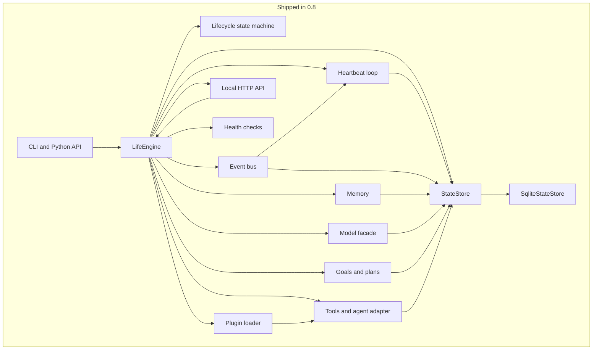

# Architecture

AI Life Engine is a library, not a set of services. One Python process owns one runtime record in one SQLite database. Later phases can add loops and adapters behind the same handle. They must not be required to boot it.

## Shape



`run()` keeps the process alive until `request_stop()` or a handled signal. With no `heartbeat_interval`, that wait does not tick and does not call a model. It still delivers events. With an interval, the same wait runs the heartbeat, and a delivered event can wake it early. `start` and `stop` are unchanged. A tick calls a reasoner only when the configured policy returns `required=True` and a reasoner was supplied. If no reasoner was supplied and a model provider is selected, that same decision calls the provider. The default policy never does that. Pending goal steps are counted as tasks. A tick does not plan them, does not execute them, and does not call a tool. Publishing an event does not call a reasoner.

## Heartbeat

The loop is intentionally small:

```text
wake → if paused or asleep, skip → inspect state → inspect tasks → policy → maybe reasoner → persist
```

| Piece | Role |
| --- | --- |
| `IntervalScheduler` | Wait for the interval, a wake event, or stop. Stop wins if both are set. |
| `NeverReasonPolicy` | Default. `required` is always false. |
| `EmptyTaskSource` | Default. Reports that no tasks are waiting. This is not a planner. |
| `Heartbeat.sleep` / `wake` | Suspend or request interval ticks. This is not lifecycle pause. `wake` is a scheduler signal. The event bus is separate. |
| Reasoner | Optional. Called only after the policy asks, on a worker thread, with a timeout. |

Sleep is persisted and stays in effect across a restart until `wake`. A loop that dies in progress is marked recovered on the next `run`. After `heartbeat_max_failures` consecutive tick failures (default 5), the heartbeat status becomes `failed` and interval ticks stop. The runtime stays up until `request_stop`. `wake` clears that failure and ticks again.

Tick history keeps the newest 50 rows. A lifecycle checkpoint is not written on every tick.

The shortest accepted interval is 0.01 seconds and the longest is 86400. That floor is there to keep a misconfigured loop from spinning. A scheduler that returns an interval wake while the loop asked it to wait for an event is delayed by a short guard sleep.

## Events

`engine.events.publish(type, source=..., payload=...)` inserts a pending row and returns that row. Handlers registered with `subscribe` run only while `run()` is active, on the engine's event loop, one event at a time. `"*"` matches every type. Subscriptions live in the process. The log is what survives a restart.

A second handle, or the `publish` command, writes the same table. The running loop polls `event_poll_seconds` (default 0.25) and also wakes immediately when `publish` happens in-process. After a delivery, and only when a heartbeat interval is set, the bus calls `heartbeat.wake("event")`. That is how an external event shortens a long interval. With no interval, `tick_count` stays 0.

An event with no subscriber stays pending. It is not spun on. The next `run` that has a matching subscriber delivers it once. Events that already reached `delivered` or `failed` are not replayed. A handler timeout or exception marks that one event `failed` and leaves the process running.

Pending events are capped at 100. Finished events keep the newest 100 rows. Pending rows are not deleted by that trim. Types and sources are short lowercase names. Payloads are string maps and reject secret-looking keys. The lifecycle does not emit events by itself.

## Memory

`engine.memory` stores three kinds of text:

| Kind | Write | Shape | Bound |
| --- | --- | --- | --- |
| Working | `remember_working(key, value)` | One value per key. Replace in place. | 32 keys. A new key past the cap raises. |
| Episode | `remember_episode(summary)` | Append-only log. | Newest 200 rows. |
| Fact | `remember_fact(key, content)` | One statement per key. The fact id stays stable when the content changes. | 200 keys. |

`search(query)` finds a case-insensitive substring in keys and text. `kind` limits the search to one store. There is no embedding and no model call.

Records survive `close()` and a new process on the same data directory. They are not events. Writing memory does not wake the heartbeat. An application that wants a tick publishes an event itself.

Keys are short lowercase names. Values, summaries, and fact content are single-line printable text of at most 500 characters. Payloads reject secret-looking keys. `initialize` or `start` must run before the first write.

## Models

`engine.brain.use(provider)` selects a provider. `complete(prompt)` sends one request and stores usage. The prompt is not stored. `open_model("echo")` returns the prompt locally. `open_model("openai-compatible", base_url=..., model=...)` POSTs chat-completions JSON with the standard library. No vendor SDK is imported.

Nothing is selected at construction. `run` does not call a provider unless a reasoning policy sets `required=True`, no reasoner was passed to the constructor, and a provider has been selected. The default policy does not set `required`. A failed call records `error`, warns on the `brain` health check, and leaves the process running.

`model_timeout` bounds the provider call. The default is 30 seconds. Usage keeps the newest 200 rows.

## Goals

`engine.goals.add` stores an active goal. `plan` replaces its accepted plan with caller-supplied steps and does not call a model. `propose` asks the selected model for lines and then stores that plan. The heartbeat does not call `propose`.

`next_action` returns the pending step of the most urgent active goal. Priority 1 comes before priority 5. Blocked, done, and dropped goals are skipped. The step is text. It is not executed.

`reflect` records an outcome. `succeeded` and `skipped` advance a step. The goal becomes `done` when the accepted plan has no pending step. `blocked` marks the goal blocked. `failed` and `noted` only store the note.

A runtime keeps 50 goals, 5 plans per goal, and 200 reflections. With no custom task source, a heartbeat tick counts pending steps. Zero goals still means nothing is waiting. The default reasoning policy does not call a model because of that count.

## Tools

`engine.agents.register` adds a tool. `allow` grants its permission for this process only. The grant is not stored. `call` runs the tool when the permission is granted and records the outcome. `use` selects an adapter. `step` lets that adapter choose one granted tool, then uses `call`.

`echo`, `note`, and `finish` are registered at startup and denied. `echo` returns the argument. `note` stores an episode. `finish` marks the current next action succeeded. A custom tool is any object with `name`, `description`, `permission`, and `call(argument)`.

The heartbeat does not call `step` or `call`. A denied or failed call warns on the `agents` health check and leaves the process running. Tool-call rows keep the newest 200 outcomes and do not keep the raw argument.

## Plugins

`engine.plugins.install(plugin)` calls `plugin.setup(context)` for one object. `load()` does the same for every entry point in the group `ai_life_engine.plugins`. Importing the package and constructing an engine do not scan entry points.

The context can register a tool, a health check, or an event handler. It cannot grant a permission, call a tool, or change the lifecycle. A tool registered by a plugin stays denied. A failed setup is stored in memory and the next plugin still loads. The `plugins` health check warns when any record failed.

## Local API

`ai_life_engine.api.create_server` binds a standard-library HTTP server. The default address is loopback port 8765. A non-loopback host requires `allow_remote`. The server reads health, status, goals, the next action, tools, and plugin records. It can call a tool that this process has already granted, and it can publish an event. A request body cannot grant a permission. There is no authentication. Schema version stays at 7.

## Lifecycle

A handle has an in-memory state. The database has the last committed state. They match while this process owns the runtime.

| State | Meaning |
| --- | --- |
| `created` | This handle has not claimed a runtime |
| `starting` | Claim is being written |
| `recovering` | A previous crash or failure is being taken over |
| `running` | This process owns the runtime |
| `pausing` / `paused` | Owned, intentionally not running |
| `resuming` | Returning from pause to running |
| `stopping` / `stopped` | Shutdown in progress or complete |
| `failed` | The last claim could not finish |

Transitions are explicit. `start()` on a live process that already holds the record raises `LifecycleError` with code `foreign_runtime`. A dead pid, or a record in `failed`, is recovered on the next `start()` and `recovery_count` increases by one.

`stop()` when this handle does not own the runtime does nothing to the database. That keeps a second handle from marking someone else's runtime as cleanly stopped.

Pause and resume keep the same `run_id`. A later `start()` after a stop creates a new one.

## Persistence

Schema version 7 stores exactly one engine row per database, plus one heartbeat row, a capped tick history, an event log, memory tables, a model usage log, goal tables, and a tool-call log. Version 1 through 6 databases are upgraded in place by adding the missing tables. Any other version is rejected. The engine row carries a `generation` counter. A write must present the generation it read. The record, one audit row, and one checkpoint commit together or not at all. Heartbeat updates use their own generation and do not write a lifecycle checkpoint. Event rows, memory rows, model usage rows, goal rows, and tool-call rows do not write one either.

SQLite is opened with WAL, `synchronous=FULL`, a busy timeout, and foreign keys. The data directory is created mode `0700` and the database file mode `0600` on platforms that honor those bits. The filesystem root is rejected as a data directory.

PostgreSQL is a future `StateStore`, not a class in this tree.

## Health

`health()` never has to succeed at storage to return a report. A storage error becomes an unhealthy report. Built-in checks are:

| Check | Pass | Warn or fail |
| --- | --- | --- |
| `storage` | Database answers | Unreachable or closed |
| `lifecycle` | Running, paused, or intentionally idle | Failed, or a transitional state |
| `consistency` | Memory matches the database, or the last stop was clean | Another process holds it, or recovery is required |
| `heartbeat` | Idle, asleep, or a fresh beat | Stale beat, or a previous failure. A running loop that has given up fails the check |
| `events` | No events, a pending event, or a delivered event | The latest event's handler failed. That is a warning |
| `memory` | No memories, or any stored memory | This check does not warn or fail |
| `brain` | No model calls, or a successful call | The latest model call failed. That is a warning |
| `goals` | No goals, or every active goal has a plan | A goal is blocked, or an active goal has no plan. That is a warning |
| `agents` | No tool calls, or a successful call | The latest tool call was denied or failed. That is a warning |
| `plugins` | No plugins, or every setup loaded | A plugin failed to load. That is a warning |

Overall status:

| Status | When |
| --- | --- |
| `healthy` | This process is running or paused and every check passed |
| `inactive` | This process has not started it, and nothing is wrong |
| `degraded` | A check warned. Typical case: recovery is required, or another process holds the runtime |
| `unhealthy` | A check failed |

Callers can register more checks. Those checks receive a snapshot. They must be fast, and they cannot call lifecycle methods. The names `storage`, `lifecycle`, `consistency`, `heartbeat`, `events`, `memory`, `brain`, `goals`, `agents`, and `plugins` are reserved.

An idle heartbeat passes, an empty event log passes, and an empty memory store passes, so a runtime that never sets an interval, never publishes, and never remembers still reports `healthy` while it is running. A failed handler warns, so the report becomes `degraded` while the process stays up. Stored memory does not change that.

## What is deliberately absent

`ai_life_engine.heartbeat`, `ai_life_engine.events`, `ai_life_engine.memory`, `ai_life_engine.brain`, `ai_life_engine.goals`, `ai_life_engine.agents`, `ai_life_engine.plugins`, and `ai_life_engine.api` are real packages. `ai_life_engine.adapters` is not a package. Vendor frameworks are not imported.

Capabilities are reported by `runtime_capabilities()` and `LifeEngine.capabilities`. Unsupported features are `False`.

## Security boundary in this version

The core does not spawn a shell and does not read API keys from the environment. It opens a network connection only for `HttpChatProvider` or the local HTTP API, and only when the application asks. Metadata keys that look like credentials are rejected. Audit reasons are reduced to a single printable line. List APIs accept a limit from 1 to 1000.

Tools run only after this process grants a permission. There is no human approval step, rate limit, or per-tool timeout. A heartbeat reasoner is not a tool runner. The default policy does not call one, and a configured reasoner is bounded by `reason_timeout`. An event handler is bounded by `event_handler_timeout`. A handler failure does not stop the runtime.

## Process model

Lifecycle methods are synchronous because the store is local and the critical sections are short. `run()` is async so the heartbeat and the event watcher can share the same event loop. The loop does not hold the runtime lock across an await, including across a handler. `request_stop()`, `heartbeat.wake()`, and `events.publish()` are safe to call from another thread. `publish` does not run handlers on that thread.

Do not take over a runtime whose pid still looks alive. Pid reuse can cause a false conflict. The remedy is to stop the real process, or to use another data directory. There is no force-unlock flag.
